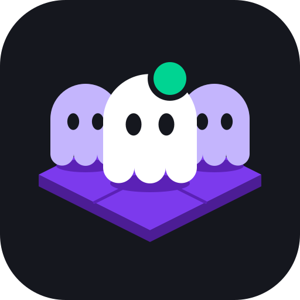
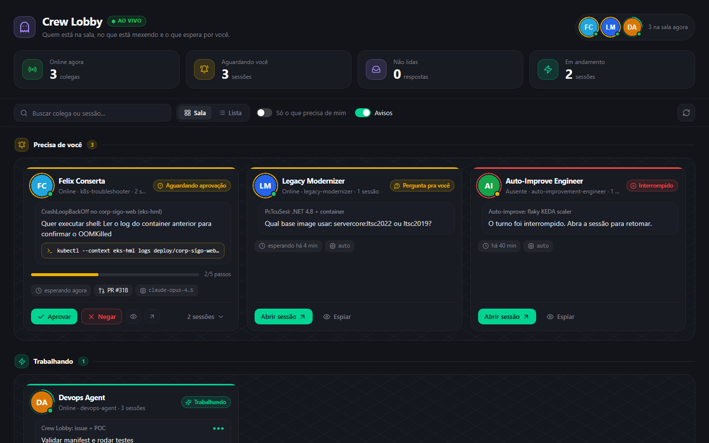
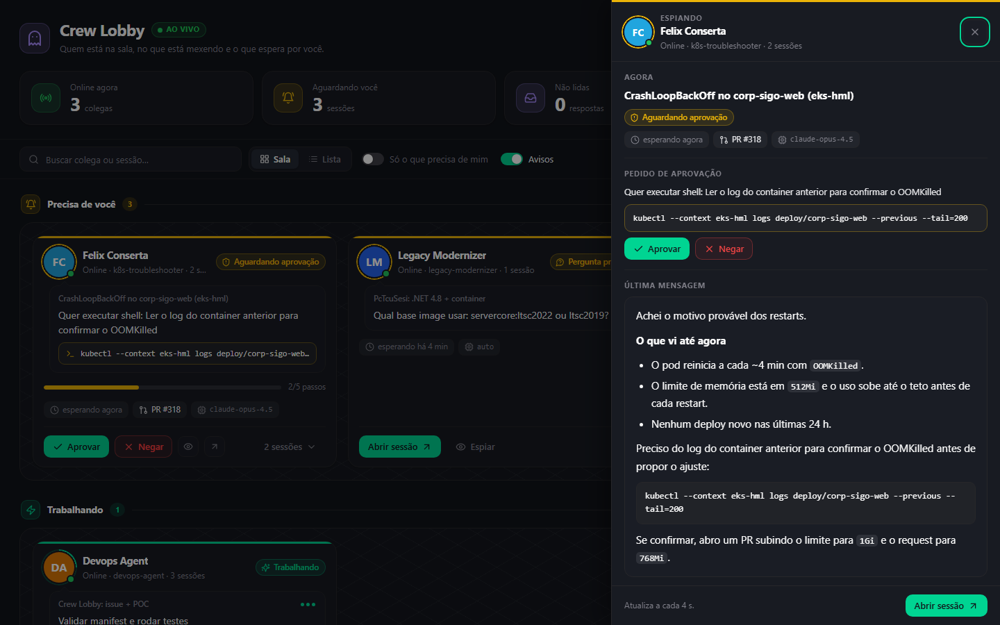
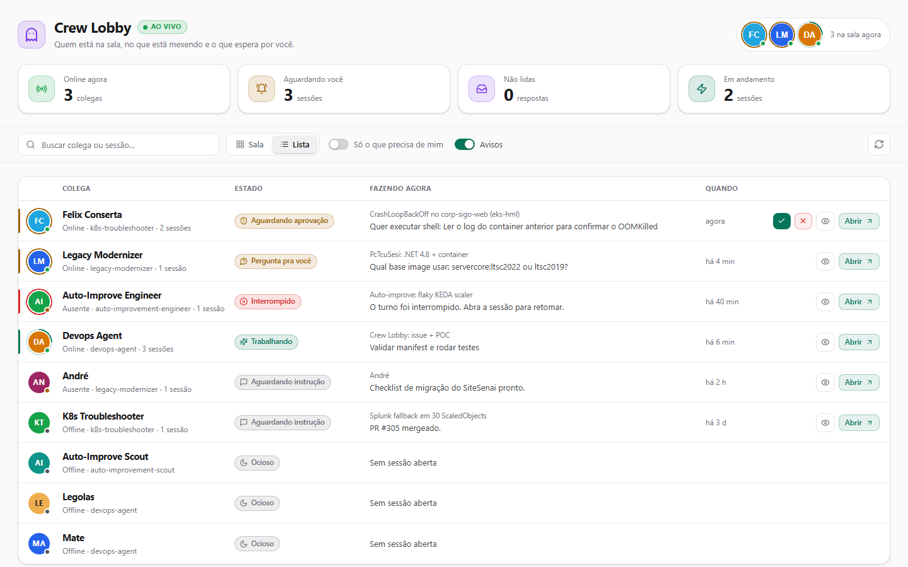

# Crew Lobby (POC)

Painel social da Crew em estilo lobby (inspirado no Habbo, sem gamificação). Cada colega ganha uma "mesa" com presença, o que está fazendo, se espera aprovação ou instrução, e o que terminou e você ainda não viu. Dá para aprovar ou negar um pedido ali mesmo e espiar a sessão sem sair do lobby. Um clique abre a sessão.

Autor: Nathan Seixeiro.

**Status:** POC 0.5.0. Issue rascunhada em `issue.md` (não enviada).





## Estrutura

| Caminho | O que é |
|---|---|
| `app/app.json` | Manifest do app Crew `crew-lobby` |
| `app/ui/index.mjs` | UI inteira, sem build. React + SDK do host via `window.__kirocrew_modules` (mesmo contrato do Agent Worlds) |
| `app/ui/icon.svg` | Ícone do menu |
| `app/assets/icon.svg` | Logo da página do app na Crew |
| `app/backend/routes.py` | Rota só de leitura do Espiar: a última resposta completa de uma sessão |
| `preview/` | Preview local com dados simulados. Um worker passa por trabalhando → aprovação → trabalhando → terminou a cada 60 s |
| `test/lobby.test.mjs` | Testes de lógica e render (`node:test`) |
| `test/test_backend.py` | Testes da rota do backend, com o Python da própria Crew |
| `test/validate-manifest.py` | Valida o manifest com o validador da própria Crew |
| `app/assets/screenshots/` | Prints da página do app na Crew (sala, Espiar, lista) |
| `preview/screenshots/` | Prints da 0.3.0, citados na issue |
| `issue.md` | Texto da issue para `kirodotdev/KiroCrew` |

## Ver o preview (não instala nada)

Na raiz do repositório:

```powershell
node preview/server.mjs
```

Abra http://127.0.0.1:5480/. Parâmetros: `?at=25` (começa em "aguardando aprovação"; `?at=40` termina em 5 s e vira não lido), `?view=list`, `?theme=light`, `?lang=en`, `?peek=1` (abre o Espiar na mesa com pedido), `?bare=1` (sem a barra lateral, usado nos prints). Aprovar/Negar funcionam no preview: o worker segue na hora. Tema e idioma também trocam pela barra lateral do preview. Só o preview baixa React e lucide do esm.sh; dentro da Crew o app usa os do host.

Visual: plano, sem degradê nem brilho. Tokens reais do tema da Crew (`--accent` verde para ações e "trabalhando", `--aim` roxo do Kiro para marca e não lido), ícones lucide do host, faixa de cor do estado no topo de cada mesa, cards de número que filtram, rostos de quem está na sala (clique leva à mesa), anel no avatar (gira trabalhando, pulsa esperando você), balão de fala com a atividade, barra de passos, grade isométrica discreta no piso. Respeita "reduzir movimento".

## Instalar na Crew

Na raiz do repositório (Windows, Crew desktop):

```powershell
$crew = "$env:LOCALAPPDATA\Programs\KiroCrew\resources\backend-dist\kirocrew-backend\python.exe"
& $crew -m kiro_crew app install .\app
```

Depois, no dashboard: **Apps** → **Crew Lobby** → **Ativar** → **Confiar neste app e ativar**. A mesma janela avisa que o app pede para controlar seus chats: é isso que libera o Aprovar/Negar. Pela CLI não dá: a Crew só aceita esse consentimento no dashboard, e no Windows a CLI só grava arquivos, sem avisar o gateway que está rodando. O app tem uma rota de backend em Python, só de leitura, que roda dentro do gateway (`app/backend/routes.py`); a confiança no app é o que permite carregá-la.

Página **Crew Lobby** no menu (rota `/crew-lobby`). Se não aparecer, recarregue o dashboard.
Atualizar: `app uninstall crew-lobby` e `app install .\app` de novo (a Crew pode pedir a confiança outra vez).
Remover: `& $crew -m kiro_crew app uninstall crew-lobby`.

Permissões: `GET /api/chat/slots`, `GET /api/agents` e `POST /api/chat/slots/{slot}/approve`, com `sessionApproval`. Sem eventos. Na Crew, `sessionApproval` também cobre enviar mensagens, escolher opções e trocar o modo de aprovação; o app só chama a rota de aprovação, e só quando você clica. A rota própria `GET /api/apps/crew-lobby/last-message` devolve a última resposta de uma sessão com a redação de credenciais da Crew, até 6.000 caracteres, e recusa sessões privadas (incógnito ou temporárias).

## Regras

| Info | Regra | Campo da Crew |
|---|---|---|
| Colega | DM do crewmate (`member-<slug>…`), depois sessões que ele abriu (`created_by`), senão o agente da sessão | `key`, `created_by`, `agent` |
| Online | trabalhando, esperando você, ou ativo há menos de 15 min | `running`, `pending_approval`, `needs_input`, `last_activity_ts` |
| Ausente / Offline | ativo nas últimas 24 h / sem sessão ou parado há mais de 24 h | `last_activity_ts` |
| Aguardando aprovação | aprovação pendente, com ferramenta e motivo | `pending_approval`, `pending_approval_info` |
| Pergunta pra você | card de pergunta aberto | `needs_input` |
| Trabalhando | turno rodando ou compactando, com passos do todo e fila | `running`, `compacting`, `todo`, `queue_depth` |
| Sem saída | trabalhando sem linha nova há 10+ min | `last_activity_ts` |
| Interrompido | turno cortado | `interrupted` |
| Terminou · não lido | agente respondeu depois da última vez que você abriu pelo lobby | `last_agent_ts` vs. localStorage |
| Aguardando escolha / instrução | terminou com opções / terminou e você já viu | `has_options`, `waiting_for_input` |
| Extras | link do PR, modelo, tempo no estado, app de origem | `source_links`, `served_model`, `last_turn_ts`, `app` |
| Cor do avatar | cor do avatar do crewmate, senão a cor de sessão, senão paleta fixa | `avatar.bg`, `session_color` |
| Aprovar / Negar | só o pedido do próprio chat (`origin: native`); envia `approved` ou `rejected_once`, como os botões do dashboard | `pending_approval_info.request_id`, `request_mid` |
| Espiar | pedido com o comando completo, a última resposta inteira (com listas, código e tabelas), plano, opções e outras sessões do colega. Clicar no balão da mesa abre o Espiar | `pending_approval_info.tool_input`, `/last-message`, `todo.tasks`, `options` |

Também: toast quando alguém entra em aprovação, pergunta, interrompido ou terminou; badge no menu (precisa de você + não lidas); busca; filtro "só o que precisa de mim"; visão Sala ou Lista; Enter na mesa abre a sessão.

## Limitações

- "Não lido" é por navegador (localStorage) e só zera ao abrir pelo lobby. Abrir pela sidebar não marca como lido. A versão nativa precisa de `last_seen` por sessão no servidor (pedido na issue).
- Avatar enviado não aparece: `GET /api/agents/{name}/avatar` é só para o dono. O app usa iniciais e cor.
- Polling a cada 4 s (15 s com a aba oculta). Sem eventos ao vivo: o socket de um app só recebe eventos das sessões do próprio app (`slots:own`), então eventos não ajudariam aqui.
- Status de CI do PR não aparece: a Crew não envia `ci`/`state` dos links para apps. Fica só o link.
- O desenho do avatar (`pose`) é do bundle interno do dashboard; o app usa só a cor (`bg`) com as iniciais.
- Avisos e contador do menu só atualizam com a página do Lobby aberta: um app só de UI não roda em segundo plano.
- A lista de sessões da Crew traz só 80 caracteres da última mensagem; o Espiar lê a resposta inteira pela rota do backend. O resto da conversa fica na sessão. Sessões privadas mostram só a prévia, e se a rota não responder (app sem confiança, gateway antigo) o Espiar também cai na prévia.
- Pedido de processo em segundo plano (cron, subagente) não pode ser decidido por app; o lobby avisa para decidir na sessão.
- Aprovar/Negar ainda não foi testado com um pedido real dentro da Crew.

## Validação

- `node --check` em todos os módulos: OK
- `node --test test\lobby.test.mjs`: 17/17
- `test\test_backend.py` com o Python da Crew: 8/8 (inclui a redação real de credenciais e a recusa de sessão privada)
- `test\validate-manifest.py` com o Python da Crew: `manifest crew-lobby 0.5.0: OK`
- Servidor de preview: rotas 200, `server.mjs` e traversal 404
- Prints com Edge headless (sala, Espiar, lista clara) conferidos visualmente
- Instalação 0.4.0 na Crew local: `app install` OK; o gateway serve `/apps/crew-lobby/ui/index.mjs` (200). A rota dos prints (`/apps/crew-lobby/art/...`) exige login do dashboard, então só dá para conferir na própria Crew.
